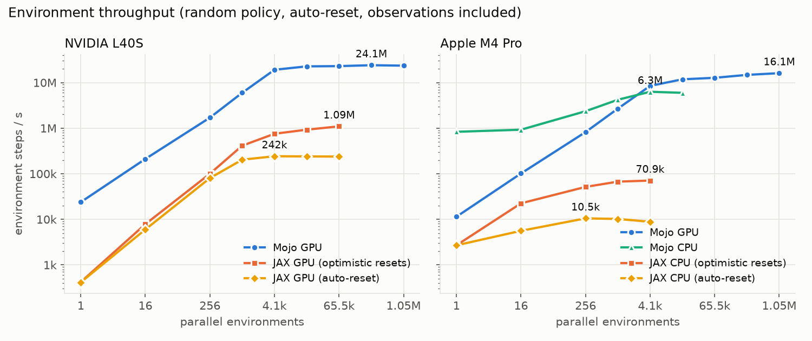
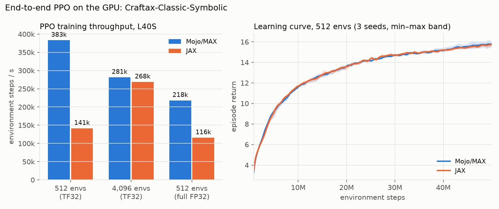

# craftax-mojo

A Mojo/MAX port of [Craftax-Classic](https://github.com/MichaelTMatthews/Craftax)
(the JAX re-implementation of [Crafter](https://github.com/danijar/crafter)),
symbolic observations, built to compare environment throughput against JAX on
CPU, Apple GPU and NVIDIA GPUs.





Environment-only, Mojo peaks at 24.1M steps/s on an L40S, 22x JAX's best
(1.09M); on the M4 Pro CPU it is 89x faster than JAX on CPU. End to end, the
Mojo/MAX PPO trainer is 2.7x faster than the jitted JAX trainer at 512 envs
and learns the same (return 15.70 vs 15.62 over 3 seeds x 50M steps).
Full tables: environment throughput [`results/summary.md`](results/summary.md);
end-to-end PPO training [`results/train_summary.md`](results/train_summary.md).
Figures are drawn by `uv run --with matplotlib python results/plot.py`.

## Fidelity

The port follows `craftax_classic/game_logic.py`, `world_gen.py` and
`renderer.py::render_craftax_symbolic` rule by rule, including JAX's quirks:

- out-of-bounds reads wrap negative indices then clamp; out-of-bounds writes
  are dropped (e.g. stepping off the map edge onto wrapped lava ends the game);
- dead mobs and arrows keep moving, zombie hits grant `WAKE_UP`, spawn
  bookkeeping re-asserts `mob_map` even when nothing spawns;
- XLA's jit rewrites are matched: float16 `x/10` becomes `x * f16(0.1)`,
  `t/300` becomes `t * (1/300)`, and the reward is one FMA.

**Parity test** (`parity/`): every random draw JAX makes is recorded (25 per
step, 17,021 per world) and replayed in Mojo, so both implementations see
identical randomness. Each transition starts from the JAX state, and state,
reward, done and the 1,345-float observation are compared after every step.
The suite runs 90 episodes x 300 steps (27,000 transitions), mixing random
play, perturbed inventories/intrinsics/timesteps, and staged scenes with ores,
tables, plants and mobs next to the player; all 22 achievements fire. Every
transition matches exactly. The only tolerance is light level, where XLA's
and Mojo's `cos` differ by at most 1.8e-7 (one float32 ulp) on 1.5% of
timesteps; it feeds the zombie spawn probability, so a flipped spawn is
possible but has a probability of about 1e-7 per step.

**Statistics** (`parity/test_distribution.py`): with each side using its own
RNG, per-world block counts (512 worlds) and random-policy rollout statistics
(terminations, reward, per-achievement unlock rates over 512 envs x 400
steps) agree with JAX within |z| < 1.9.

**Device identity** (`tests/test_gpu_cpu.mojo`): the benchmark RNG is
counter-based and per-env, so the CPU and GPU paths must produce the same
trajectories from the same seed. They do, bit for bit, on the M4 Pro GPU and
an L40S (2,048 envs x 1,000 steps, ~12k resets). This needs two things:
builds use `--fp-mode contract=off` (backends otherwise fuse different
multiply-adds), and world generation uses its own Cephes-style `sin`/`cos`
built from IEEE add/mul, because library trig rounds differently per device
(`tests/diag_trig.mojo`: up to 1 ulp on Apple, ~6 ulp on NVIDIA, which
occasionally flipped a noise threshold).

## End-to-end PPO (phase 2)

Both trainers run the whole training loop on the GPU, with the same
algorithm and hyperparameters (baxtub's `ppo.crafter.yaml`): 512 envs x 64
steps per batch, separate 3 x 512 tanh actor and critic MLPs, 4 epochs x 8
minibatches, Adam 2e-4 with linear annealing and global-norm clipping at 1.

- `train/ppo_jax.py`: a functional port of baxtub's `ppo.py`, one jitted
  `lax.scan` over batches, with optimistic resets as in baxtub.
- `craftax_mojo/ppo.mojo` (`train/ppo_mojo.mojo`): a Mojo program whose
  host only enqueues GPU work: environment kernels writing observations into
  the rollout buffer, on-device sampling, GAE, shuffling, PPO loss gradients,
  clipping and Adam as Mojo kernels, and GEMMs through cuBLAS
  (`cublasGemmStridedBatchedEx`, bound via MAX's cuBLAS loader; actor and
  critic layers run as one batched GEMM). MAX has no autodiff, so the
  backward pass is written by hand. Finished envs get exact resets.

GAE differs from baxtub in both: it masks with the transition's own done
flag and bootstraps from V(next obs) (PureJaxRL / Craftax baselines);
baxtub masks with the next transition's done and bootstraps from the last
stored value.

**Correctness**: `parity/test_ppo_update.py` runs one Mojo update on the
same parameters and minibatch as `jax.grad` + optax (46% of ratios clipped,
gradient clipping active): gradients agree to 5e-7 (9e-6 on cuBLAS with TF32
off), clipping + Adam land within 2 ulp of a float64 reference, and loss
terms and GAE match to rounding. Learning curves over 3 seeds agree.

Both default to TF32 matmuls on NVIDIA (JAX's default precision on the L40S
is TF32; measured relative error 2.8e-4 vs 6.8e-7 at `highest`).

```bash
./build/ppo_mojo --total-steps 5e7 --seed 0 --out results/train/mojo.json [--profile 1]
uv run python train/ppo_jax.py --total-steps 5e7 --seed 0 --out results/train/jax.json
LABEL=l40s bash scripts/train_all.sh     # the full sweep (docker image)
uv run python results/summarize_train.py
```

Apple GPUs: MAX has no vendor BLAS there and no general float32 matmul with
transposes, so Mojo training on Metal uses a naive GEMM kernel and is only
useful as a functional test.

## Layout

```
craftax_mojo/
  constants.mojo   constants mirrored from constants.py / EnvParams
  state.mojo       flat state layout; env- or field-major; JAX index semantics
  rng.mojo         Rng trait: SplitMix (benchmarks) and Tape (JAX replay)
  worldgen.mojo    world generation + Perlin noise
  game.mojo        craftax_step
  obs.mojo         symbolic observation
  vec.mojo         batched auto-reset stepping, CPU (parallelize) + naive GPU
  gpu.mojo         GPU pipeline: step kernel + block-cooperative reset kernel
  gpu_host.mojo    host driver for the GPU pipeline
  nn.mojo          GEMM dispatch + PPO kernels (sampling, loss, GAE, Adam...)
  ppo.mojo         end-to-end PPO trainer
python/            Python extension (reset/step/tape replay via numpy addresses)
parity/            JAX tape recorder and transition-level parity tests
bench/             bench_mojo (standalone binary), bench_jax.py
tests/             GPU vs CPU identity, PPO update check, trig and GEMM diagnostics
train/             PPO entry points: ppo_jax.py, ppo_mojo.mojo
docker/            image for the FLAIR NVIDIA nodes
scripts/           build.sh, bench_all.sh
results/           raw JSONL, summarize.py, summary.md
```

## Running

```bash
uv sync
./scripts/build.sh                       # build/craftax_mojo_ext.so, build/bench_mojo
cd parity && uv run pytest -q            # JAX parity (~45 s)
uv run mojo run -I . --fp-mode contract=off tests/test_gpu_cpu.mojo 1024 500

./build/bench_mojo cpu 1000 1,256,4096   # Mojo CPU
./build/bench_mojo gpu 200 65536         # Mojo GPU (Metal or CUDA)
uv run python bench/bench_jax.py --mode optimistic --sizes 256,4096

LABEL=m4pro SKIP_JAX_GPU=1 bash scripts/bench_all.sh   # full sweep, Mac
uv run python results/summarize.py
```

macOS: Mojo's GPU path needs Xcode's Metal toolchain
(`xcodebuild -downloadComponent MetalToolchain`), and linking needs Xcode's
SDK because Mojo's linker can't parse the macOS 27 Command Line Tools stubs
(`build.sh` sets `SDKROOT`).

FLAIR nodes (see `docker/Dockerfile`):

```bash
docker build -f docker/Dockerfile --build-arg UID=$(id -u) --build-arg GID=$(id -g) -t ${USER}_craftax-mojo .
docker run --rm --gpus '"device=1"' -v $(pwd):/app -e MOJO=mojo -e PYTHON=python \
  -e LABEL=l40s -e SKIP_CPU=1 ${USER}_craftax-mojo bash scripts/bench_all.sh
```

## Benchmark protocol

Random uniform actions, auto-reset, observations written every step, timed
after warm-up. Mojo is a standalone binary; JAX is one jitted `lax.scan` over
`vmap(env.step)`, sampling actions inside the scan.

JAX is measured two ways:

- **auto-reset**: Craftax's `CraftaxClassicSymbolicEnv`, which generates a
  fresh world for every env on every step and selects it on termination;
- **optimistic**: a port of `craftax_baselines`' `OptimisticResetVecEnvWrapper`
  (one fresh world per 16 envs per step), which Craftax's PPO baselines use.

Mojo regenerates a world only when an env terminates. On GPU, finished envs
are compacted into a list and regenerated by one 256-thread block each
(`gpu.mojo`); the naive fused kernel is reported for comparison.
